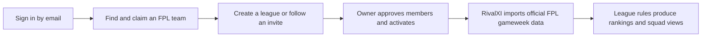
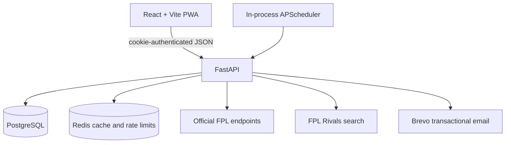

# RivalXI

Private Fantasy Premier League competitions where each gameweek is its own contest.

## Overview

RivalXI is a portfolio-stage web application for FPL managers who want a smaller, more deliberate competition than a season-long public league. A manager signs in by email, claims their official FPL team, and creates or joins an invite-only league of up to 20 people.

League owners choose when scoring starts, whether transfer costs count, and which chips are allowed. After activation, RivalXI imports official FPL picks and points, applies those league rules, and produces a gameweek leaderboard with drill-down squad views.

The project includes a React progressive web app, a FastAPI API, PostgreSQL persistence, Redis-backed caching and rate limiting, transactional email, and scheduled gameweek synchronization.

## The problem

The standard FPL season rewards consistency across 38 gameweeks. That format is not always a good fit for a group that starts late, wants short feedback loops, or wants house rules around transfer hits and chips. Running that competition by hand means repeatedly collecting scores, checking eligibility, and rebuilding a table.

RivalXI turns those recurring checks into explicit league rules and recalculates the competition from official FPL data.

## The approach

- **Passwordless onboarding** — Email one-time codes create a session, then the manager searches for and permanently claims one FPL team.
- **Private league ownership** — Owners configure a draft league, share a reusable invitation link, review applicants, and activate the competition.
- **Rule-aware weekly scoring** — Every gameweek records gross points, transfer deductions, the displayed score, chip use, and eligibility.
- **League and squad views** — Members see the weekly table and the player picks behind each result, including captain multipliers and club kits.
- **Notifications** — In-app events cover membership decisions, rule changes, deadlines, and gameweek winners; membership decisions also send email.

## How it works



FPL Rivals is used only to discover candidate manager IDs. Official Fantasy Premier League data remains authoritative for validation, picks, points, deadlines, and results.

## An interesting engineering decision: persisting rule-aware results

An FPL score is not necessarily a RivalXI score. A league may ignore transfer costs, or mark a manager ineligible for using a prohibited chip. Reading the upstream API directly on every page would also make historical tables depend on a currently available third party.

The backend therefore normalizes an FPL gameweek, applies league rules, and persists both the inputs and the resulting scoreboard value. The core decision is intentionally small:

```python
chip_allowed = chip_used is None or chip_used.value in allowed_chips
scoreboard_points = (
    fpl_gameweek.net_points
    if rules.include_transfer_deductions
    else fpl_gameweek.gross_points
)
```

Persisted results keep gross, net, and displayed points alongside eligibility, so the UI can explain a ranking rather than only show a total. Syncs are repeatable, cached responses are invalidated after writes, and final gameweeks receive a longer cache lifetime. The trade-off is operational: the scheduler currently runs inside the API process, so deployments must use a single backend worker to avoid duplicate scheduled jobs.

## Architecture



The browser never receives third-party credentials. The API owns authentication, league permissions, FPL normalization, scoring, persistence, and integration failure handling. See [Architecture](docs/architecture.md) for the request and synchronization flows.

## Technology

- **Frontend:** React 19, TypeScript, Vite, React Router, TanStack Query, Tailwind CSS, PWA support
- **Backend:** Python 3.12, FastAPI, Pydantic, SQLAlchemy asyncio, Alembic, APScheduler
- **Data:** PostgreSQL and Redis
- **External services:** official FPL web endpoints, FPL Rivals manager search, Brevo transactional email
- **Tooling and tests:** uv, Bun, Biome, Python `unittest`, Docker Compose

## Project status

RivalXI is an actively developed portfolio MVP. The main sign-in, onboarding, league, invitation, scoring, squad, and notification flows are implemented. It is not yet presented as a production-ready hosted service: PostgreSQL and frontend hosting are external to the included Compose deployment, the upstream FPL interfaces have no supported public developer contract, and the in-process scheduler limits the backend to one worker/container.

## Documentation

- [Installation](docs/installation.md)
- [Configuration](docs/configuration.md)
- [Architecture](docs/architecture.md)
- [Domain rules](docs/domain-rules.md)
- [External integrations](docs/integrations.md)
- [API guide](docs/api.md)
- [Testing](docs/testing.md)
- [Deployment](docs/deployment.md)
- [Frontend SEO and social sharing](docs/SEO.md)
- [Commit conventions](docs/commit-rules.md)

## Running locally

Copy the environment templates, configure PostgreSQL and Brevo, then run the backend/Redis stack and the frontend:

```sh
cp backend/.env.example backend/.env
cp frontend/.env.example frontend/.env
docker compose --env-file backend/.env -f compose.yaml -f compose.dev.yaml run --rm --no-deps backend alembic upgrade head
docker compose --env-file backend/.env -f compose.yaml -f compose.dev.yaml up -d --build --wait
bun install --cwd frontend --frozen-lockfile
bun run --cwd frontend dev
```

The complete clean-machine setup, including database requirements and verification, is in [Installation](docs/installation.md).
