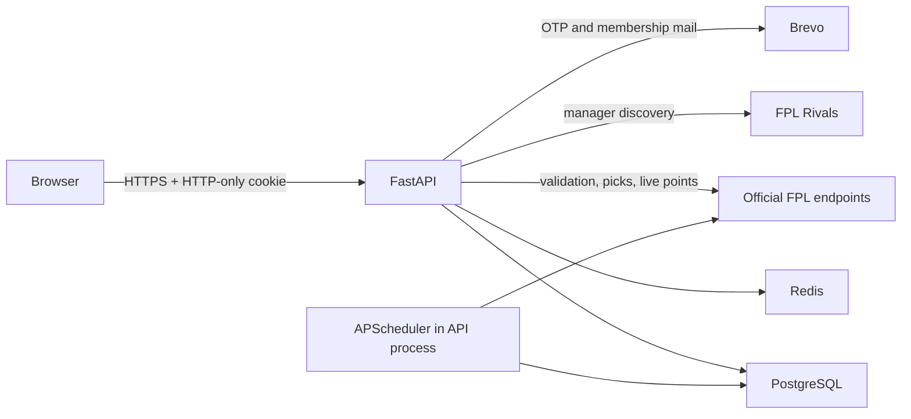
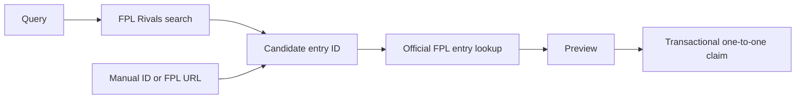

# Architecture

RivalXI is a browser client and JSON API backed by PostgreSQL and Redis. The repository is a monolith in source control, but the frontend and backend run as separate processes.

## Components

| Component | Responsibility |
|---|---|
| React/Vite frontend | Routing, forms, server-state queries, league tables, squad presentation, and PWA assets. |
| FastAPI application | Authentication, authorization, validation, league workflows, scoring, and all external-service access. |
| PostgreSQL | Durable users, sessions, claimed FPL accounts, leagues, rules, membership, invitations, results, picks, and notifications. |
| Redis | FPL and response caching, outbound FPL pacing, and authentication rate-limit counters. |
| APScheduler | Runs deadline reminders every 30 minutes and live-gameweek synchronization at the configured interval. |

## Backend boundaries

- `app/api/v1` maps HTTP requests and domain failures to responses.
- `app/services` owns workflows and transaction boundaries.
- `app/models` and `app/schemas` contain persistence and API shapes.
- `app/integrations` isolates Brevo, official FPL requests, FPL Rivals search, and FPL kit URL construction.
- `app/jobs` contains scheduled orchestration.
- `app/core` owns settings, Redis, caching, security helpers, rate limiting, and scheduler lifecycle.

The API starts Redis and HTTP clients, warms FPL bootstrap data without failing startup when FPL is down, and then starts the scheduler. Redis initialization itself is required; startup fails if Redis cannot be reached.

## Authentication flow

1. The user requests a six-digit code by email.
2. Redis applies per-email and per-IP fixed-window limits.
3. The code is HMAC-hashed before its challenge is persisted; Brevo receives the plaintext code for delivery.
4. Successful verification creates the user if necessary and stores only a SHA-256 hash of a random session token.
5. The browser receives the token in an HTTP-only, SameSite=Lax cookie.
6. Protected endpoints resolve the cookie using a separate database session, avoiding conflicts with service-level explicit transactions.

Authentication deliberately fails closed when Redis rate limiting is unavailable.

## FPL onboarding boundary

FPL Rivals is discovery only. Preview and claim call the official FPL entry endpoint. Unique indexes on both `fpl_accounts.user_id` and `fpl_accounts.fpl_entry_id` enforce one claimed team per RivalXI user and one user per FPL team. Claiming the same entry again is idempotent; replacing it is unsupported.

## Gameweek synchronization

For each active league, synchronization:

1. loads official bootstrap and live event data;
2. validates that the gameweek has started and is not before the league start;
3. fetches each eligible member's picks sequentially, sharing data across leagues during a scheduled run;
4. normalizes players, captain multipliers, transfer costs, chips, and kit metadata;
5. applies league scoring and eligibility rules;
6. replaces that league/gameweek's persisted results and picks transactionally;
7. invalidates RivalXI response caches; and
8. creates deduplicated winner notifications when a result becomes final.

Sequential FPL access and a Redis request-slot key avoid bursts against an unsupported upstream interface. Transient responses are retried with `Retry-After` or bounded exponential delays.

## Cache and failure behavior

Official FPL responses and rendered gameweek responses use Redis TTLs from configuration. Cache read/write failures are generally treated as cache misses, but Redis failure during official FPL request pacing becomes an upstream error so the service does not bypass its outbound throttle. OTP rate-limit failure also returns service unavailable.

FPL Rivals failure degrades search to an empty response with `search_available=false`; manual onboarding remains available. Brevo failure blocks OTP issuance and invalidates the undelivered challenge, while membership notification email is best-effort after the in-app notification exists.

## Operational constraint

APScheduler runs inside the API process. The Dockerfile intentionally starts one Uvicorn worker. Run one backend container per environment unless the scheduler is moved to a separately coordinated worker; otherwise each process would schedule the same jobs.

See [Domain rules](domain-rules.md) for scoring semantics and [Deployment](deployment.md) for the included runtime model.
